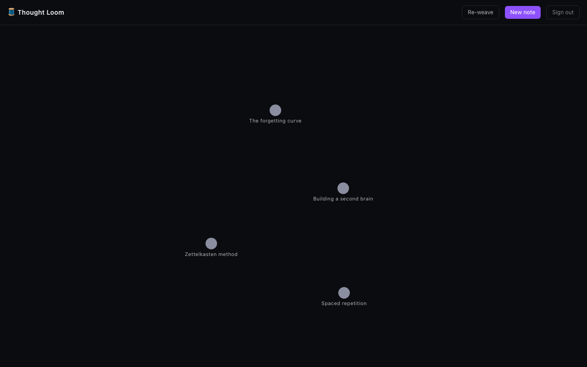

# Thought Loom

An AI-woven personal knowledge graph. Write notes; Thought Loom embeds them, suggests links between related ideas with a reasoned explanation, groups them into emergent themes, and lets you ask questions that get answered by synthesizing across your whole notebook — with citations back to the source notes.



## How it weaves

- **Auto-linking** — every note you save is embedded and compared against the rest of your notes. Genuinely related pairs (not just similar wording) are proposed as links you can accept or dismiss, each with a one-sentence reason from Claude.
- **Re-weave (clustering)** — clusters your notes by embedding similarity (k-means) and asks Claude to name each emergent theme, rendered as colored halos on the graph.
- **Ask Loom** — ask a question in plain language; the app retrieves the most relevant notes by vector search and Claude streams back an answer that cites the notes it drew from. Clicking a citation focuses that note on the graph.
- **Interactive graph** — every note is a node, every accepted link an edge, rendered on a force-directed canvas.

## Architecture

```
apps/web/            React 18 + TypeScript + Vite + Tailwind frontend
  src/lib/            Supabase client, typed API wrappers, shared types
  src/components/      graph canvas, markdown editor, link suggestions, Ask Loom chat
  src/pages/           login, signup, main graph view
  src/context/         auth session context

supabase/
  migrations/          SQL schema (Postgres + pgvector), RLS policies
  functions/            Deno edge functions — the only place AI/API keys are used
    embed-note/         OpenAI text-embedding-3-small on note save
    suggest-links/       pgvector similarity search + Claude reasoning -> pending links
    cluster-notes/       k-means over embeddings + Claude cluster naming
    ask-notes/            retrieval + Claude streaming synthesis with citations
```

Data model: `notes`, `links` (manual or ai_suggested, with a `status` for the accept/dismiss flow), `clusters` + `note_clusters`, and `chat_messages` (Ask Loom history) — all under Postgres row-level security scoped to `auth.uid()`, so every user only ever sees their own loom. OpenAI and Anthropic API keys live only as Supabase Edge Function secrets; the client never touches them.

## Setup

### 1. Supabase project

Create a project at [supabase.com](https://supabase.com), then apply the migrations in `supabase/migrations/` (via the Supabase CLI's `supabase db push`, or paste them into the SQL editor in order).

Deploy the edge functions in `supabase/functions/` (`supabase functions deploy <name>` for each of `embed-note`, `suggest-links`, `cluster-notes`, `ask-notes`), then set these secrets on the project:

```
supabase secrets set OPENAI_API_KEY=sk-...
supabase secrets set ANTHROPIC_API_KEY=sk-ant-...
```

### 2. Frontend

```
cd apps/web
cp .env.example .env   # fill in VITE_SUPABASE_URL and VITE_SUPABASE_ANON_KEY
npm install
npm run dev
```

Run `npm test` for the unit test suite (Vitest) — currently covers the citation-parsing and link-filtering logic in `src/lib/`.

## License

MIT
